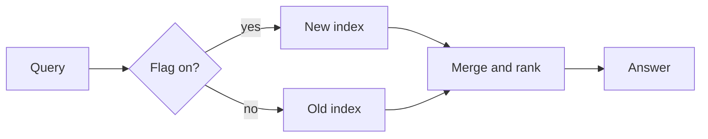

# Search index rollout

A plan for moving the docs search to the new index, written for the team and for the agents that help run it.
Each phase ships behind a flag and is reversible within one deploy.

> **Owner:** platform team · **Status:** phase 2 of 4 · **Review:** every Friday

## Checklist

- [x] Build the new index alongside the old one
- [x] Compare results on last month's top 500 queries
- [ ] Route 10% of traffic to the new index
- [ ] Retire the old index

## Phases

| Phase | Traffic | Duration | p95 latency |
| --- | ---: | ---: | ---: |
| 1 · Shadow | 0% | 7 days | 112 ms |
| 2 · Canary | 10% | 5 days | 118 ms |
| 3 · Half | 50% | 5 days | 121 ms |
| 4 · Full | 100% | — | 125 ms |

## How a query flows



## Ranking

Each result's score blends text relevance with freshness, where $t$ is the page's age in days:

$$
\text{score} = \alpha \cdot \text{bm25}(q, d) + (1 - \alpha) \cdot e^{-t / 30}
$$

We start at $\alpha = 0.8$ and tune it on the comparison set.

## The flag

```ts
// Route a share of queries to the new index, stable per user.
export function useNewIndex(userId: string, share: number): boolean {
  const bucket = hash(userId) % 100;
  return bucket < share * 100;
}
```

```python
def compare(old: list[str], new: list[str], k: int = 10) -> float:
    """Overlap of the top-k results, 0 to 1."""
    return len(set(old[:k]) & set(new[:k])) / k
```

## Rollback

1. Set the flag's share to `0`.
2. Confirm the old index serves every query.
3. Write up what happened in the incident log.
