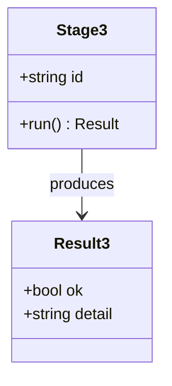
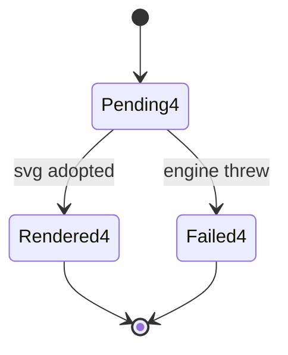
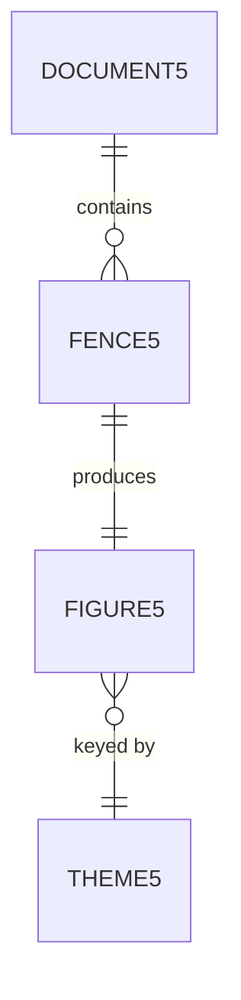
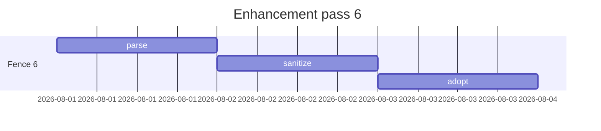
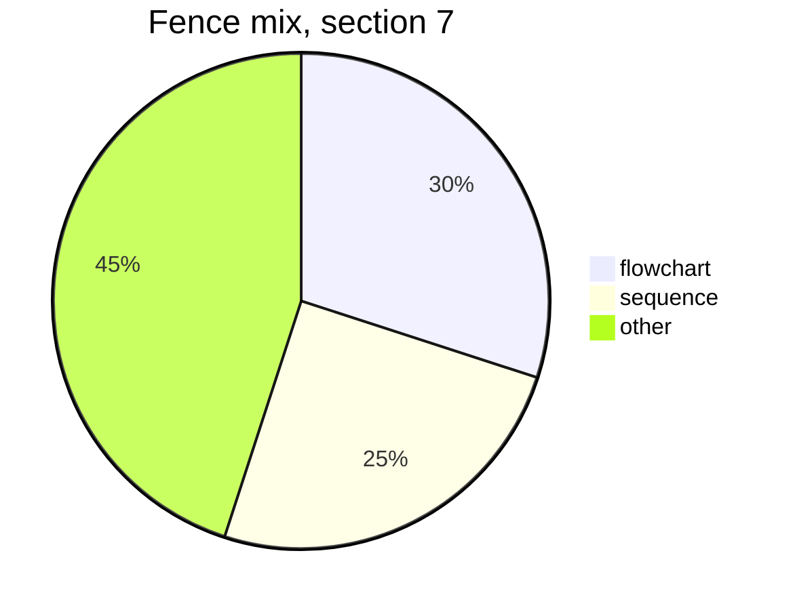
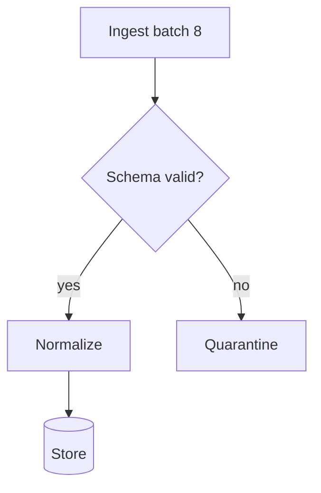
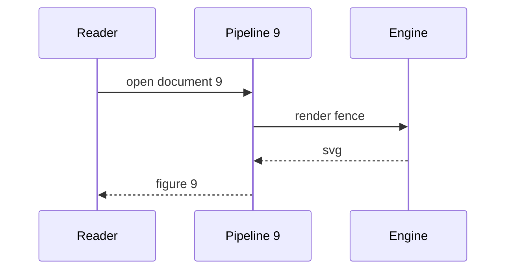
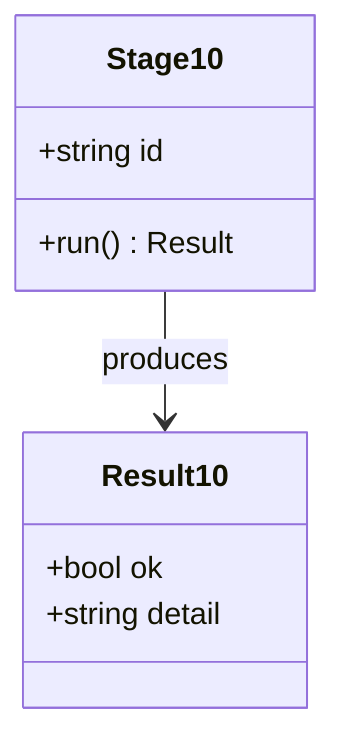

# Diagram load fixture - 10 fences

★ **WALK MATERIAL, NOT A TEST INPUT.** Nothing asserts against this file. It exists so the
9.1 gate-3 walk can open a real document at this scale and judge D-11's placeholder question
(spec 007 §8-4) on real Chromium and real Firefox, which no harness reaches. Produced by task
8.3; see `docs/ai/progress.md` § THE D-11 PLACEHOLDER RECORD for what to look for.

Every fence below is textually UNIQUE. That is deliberate and load-bearing: the diagram cache
keys on the fence source, so repeated fences would resolve from cache after the first and the
walk would see a document far faster than any real one.

## Section 1 - flowchart

Prose ahead of the fence, so the walk sees a reading column with text in it rather than a
wall of diagrams. The enhancement is post-paint (007 §3.3): this paragraph is on screen
before the engine has loaded, and the fence below is still a source fence at that instant.

Prose after the fence, so the figure lands between two blocks of text and its margins can
be judged in flow.

## Section 2 - sequence

Prose ahead of the fence, so the walk sees a reading column with text in it rather than a
wall of diagrams. The enhancement is post-paint (007 §3.3): this paragraph is on screen
before the engine has loaded, and the fence below is still a source fence at that instant.

Prose after the fence, so the figure lands between two blocks of text and its margins can
be judged in flow.

## Section 3 - class

Prose ahead of the fence, so the walk sees a reading column with text in it rather than a
wall of diagrams. The enhancement is post-paint (007 §3.3): this paragraph is on screen
before the engine has loaded, and the fence below is still a source fence at that instant.

Prose after the fence, so the figure lands between two blocks of text and its margins can
be judged in flow.

## Section 4 - state

Prose ahead of the fence, so the walk sees a reading column with text in it rather than a
wall of diagrams. The enhancement is post-paint (007 §3.3): this paragraph is on screen
before the engine has loaded, and the fence below is still a source fence at that instant.

Prose after the fence, so the figure lands between two blocks of text and its margins can
be judged in flow.

## Section 5 - er

Prose ahead of the fence, so the walk sees a reading column with text in it rather than a
wall of diagrams. The enhancement is post-paint (007 §3.3): this paragraph is on screen
before the engine has loaded, and the fence below is still a source fence at that instant.

Prose after the fence, so the figure lands between two blocks of text and its margins can
be judged in flow.

## Section 6 - gantt

Prose ahead of the fence, so the walk sees a reading column with text in it rather than a
wall of diagrams. The enhancement is post-paint (007 §3.3): this paragraph is on screen
before the engine has loaded, and the fence below is still a source fence at that instant.

Prose after the fence, so the figure lands between two blocks of text and its margins can
be judged in flow.

## Section 7 - pie

Prose ahead of the fence, so the walk sees a reading column with text in it rather than a
wall of diagrams. The enhancement is post-paint (007 §3.3): this paragraph is on screen
before the engine has loaded, and the fence below is still a source fence at that instant.

Prose after the fence, so the figure lands between two blocks of text and its margins can
be judged in flow.

## Section 8 - flowchart

Prose ahead of the fence, so the walk sees a reading column with text in it rather than a
wall of diagrams. The enhancement is post-paint (007 §3.3): this paragraph is on screen
before the engine has loaded, and the fence below is still a source fence at that instant.

Prose after the fence, so the figure lands between two blocks of text and its margins can
be judged in flow.

## Section 9 - sequence

Prose ahead of the fence, so the walk sees a reading column with text in it rather than a
wall of diagrams. The enhancement is post-paint (007 §3.3): this paragraph is on screen
before the engine has loaded, and the fence below is still a source fence at that instant.

Prose after the fence, so the figure lands between two blocks of text and its margins can
be judged in flow.

## Section 10 - class

Prose ahead of the fence, so the walk sees a reading column with text in it rather than a
wall of diagrams. The enhancement is post-paint (007 §3.3): this paragraph is on screen
before the engine has loaded, and the fence below is still a source fence at that instant.

Prose after the fence, so the figure lands between two blocks of text and its margins can
be judged in flow.
