# Diagram load fixture - 50 fences

★ **WALK MATERIAL, NOT A TEST INPUT.** Nothing asserts against this file. It exists so the
9.1 gate-3 walk can open a real document at this scale and judge D-11's placeholder question
(spec 007 §8-4) on real Chromium and real Firefox, which no harness reaches. Produced by task
8.3; see `docs/ai/progress.md` § THE D-11 PLACEHOLDER RECORD for what to look for.

Every fence below is textually UNIQUE. That is deliberate and load-bearing: the diagram cache
keys on the fence source, so repeated fences would resolve from cache after the first and the
walk would see a document far faster than any real one.

## Section 1 - flowchart

Prose ahead of the fence, so the walk sees a reading column with text in it rather than a
wall of diagrams. The enhancement is post-paint (007 §3.3): this paragraph is on screen
before the engine has loaded, and the fence below is still a source fence at that instant.


Prose after the fence, so the figure lands between two blocks of text and its margins can
be judged in flow.

## Section 2 - sequence

Prose ahead of the fence, so the walk sees a reading column with text in it rather than a
wall of diagrams. The enhancement is post-paint (007 §3.3): this paragraph is on screen
before the engine has loaded, and the fence below is still a source fence at that instant.


Prose after the fence, so the figure lands between two blocks of text and its margins can
be judged in flow.

## Section 3 - class

Prose ahead of the fence, so the walk sees a reading column with text in it rather than a
wall of diagrams. The enhancement is post-paint (007 §3.3): this paragraph is on screen
before the engine has loaded, and the fence below is still a source fence at that instant.

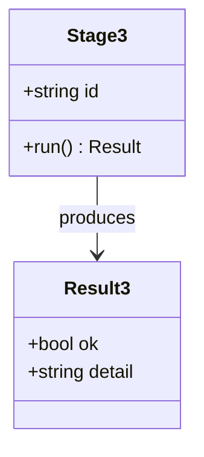

Prose after the fence, so the figure lands between two blocks of text and its margins can
be judged in flow.

## Section 4 - state

Prose ahead of the fence, so the walk sees a reading column with text in it rather than a
wall of diagrams. The enhancement is post-paint (007 §3.3): this paragraph is on screen
before the engine has loaded, and the fence below is still a source fence at that instant.

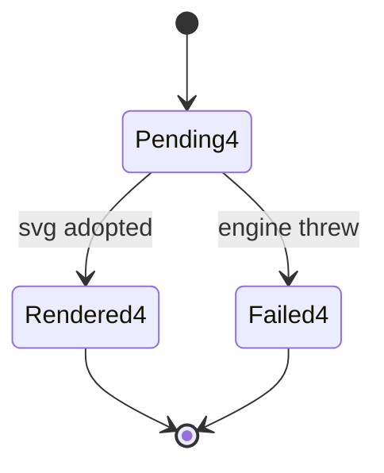

Prose after the fence, so the figure lands between two blocks of text and its margins can
be judged in flow.

## Section 5 - er

Prose ahead of the fence, so the walk sees a reading column with text in it rather than a
wall of diagrams. The enhancement is post-paint (007 §3.3): this paragraph is on screen
before the engine has loaded, and the fence below is still a source fence at that instant.

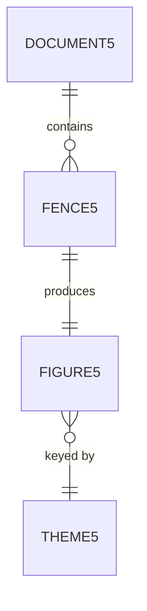

Prose after the fence, so the figure lands between two blocks of text and its margins can
be judged in flow.

## Section 6 - gantt

Prose ahead of the fence, so the walk sees a reading column with text in it rather than a
wall of diagrams. The enhancement is post-paint (007 §3.3): this paragraph is on screen
before the engine has loaded, and the fence below is still a source fence at that instant.


Prose after the fence, so the figure lands between two blocks of text and its margins can
be judged in flow.

## Section 7 - pie

Prose ahead of the fence, so the walk sees a reading column with text in it rather than a
wall of diagrams. The enhancement is post-paint (007 §3.3): this paragraph is on screen
before the engine has loaded, and the fence below is still a source fence at that instant.

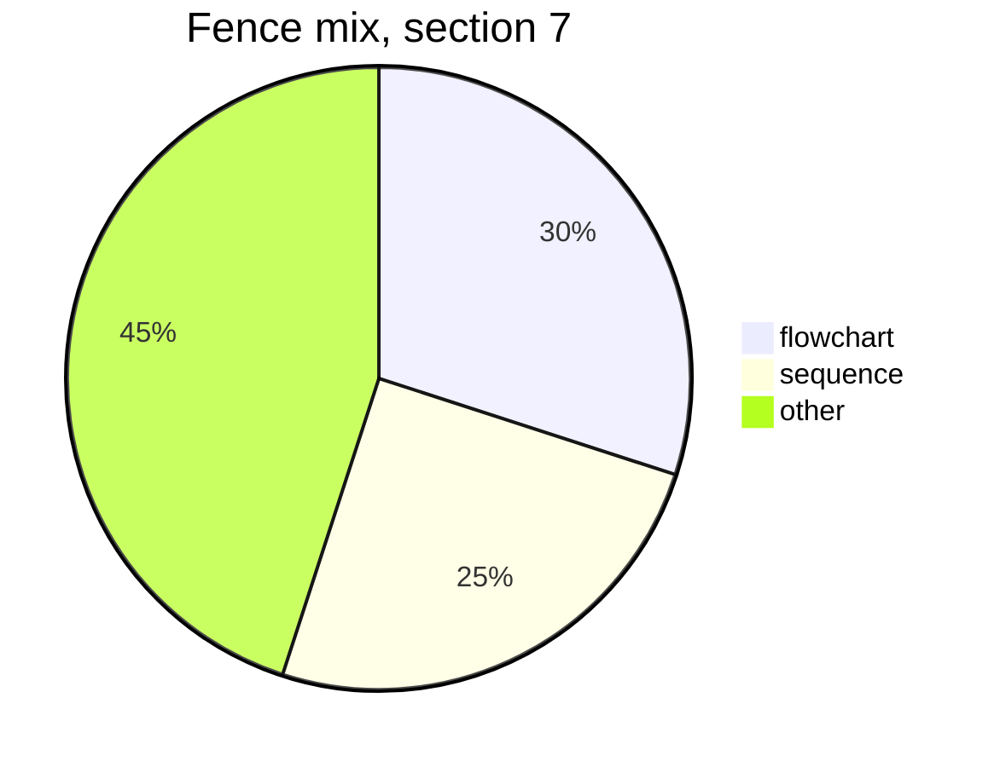

Prose after the fence, so the figure lands between two blocks of text and its margins can
be judged in flow.

## Section 8 - flowchart

Prose ahead of the fence, so the walk sees a reading column with text in it rather than a
wall of diagrams. The enhancement is post-paint (007 §3.3): this paragraph is on screen
before the engine has loaded, and the fence below is still a source fence at that instant.

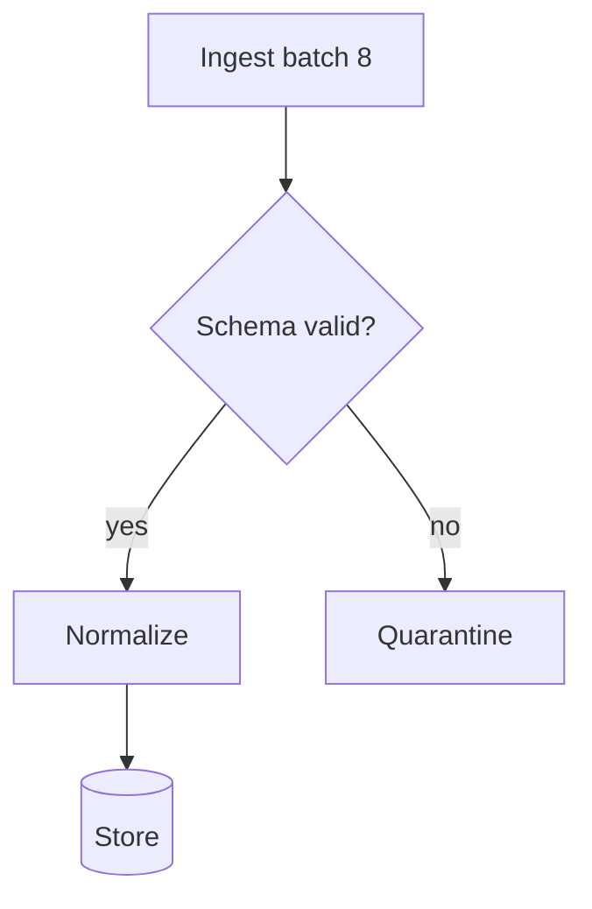

Prose after the fence, so the figure lands between two blocks of text and its margins can
be judged in flow.

## Section 9 - sequence

Prose ahead of the fence, so the walk sees a reading column with text in it rather than a
wall of diagrams. The enhancement is post-paint (007 §3.3): this paragraph is on screen
before the engine has loaded, and the fence below is still a source fence at that instant.


Prose after the fence, so the figure lands between two blocks of text and its margins can
be judged in flow.

## Section 10 - class

Prose ahead of the fence, so the walk sees a reading column with text in it rather than a
wall of diagrams. The enhancement is post-paint (007 §3.3): this paragraph is on screen
before the engine has loaded, and the fence below is still a source fence at that instant.

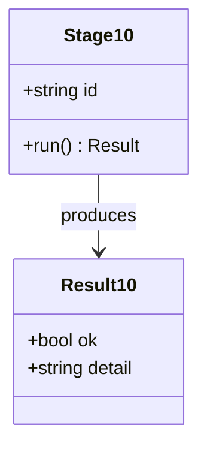

Prose after the fence, so the figure lands between two blocks of text and its margins can
be judged in flow.

## Section 11 - state

Prose ahead of the fence, so the walk sees a reading column with text in it rather than a
wall of diagrams. The enhancement is post-paint (007 §3.3): this paragraph is on screen
before the engine has loaded, and the fence below is still a source fence at that instant.

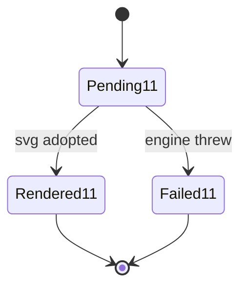

Prose after the fence, so the figure lands between two blocks of text and its margins can
be judged in flow.

## Section 12 - er

Prose ahead of the fence, so the walk sees a reading column with text in it rather than a
wall of diagrams. The enhancement is post-paint (007 §3.3): this paragraph is on screen
before the engine has loaded, and the fence below is still a source fence at that instant.


Prose after the fence, so the figure lands between two blocks of text and its margins can
be judged in flow.

## Section 13 - gantt

Prose ahead of the fence, so the walk sees a reading column with text in it rather than a
wall of diagrams. The enhancement is post-paint (007 §3.3): this paragraph is on screen
before the engine has loaded, and the fence below is still a source fence at that instant.

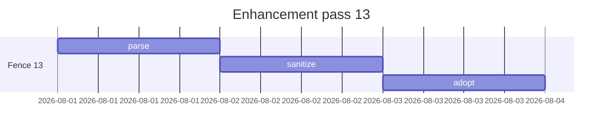

Prose after the fence, so the figure lands between two blocks of text and its margins can
be judged in flow.

## Section 14 - pie

Prose ahead of the fence, so the walk sees a reading column with text in it rather than a
wall of diagrams. The enhancement is post-paint (007 §3.3): this paragraph is on screen
before the engine has loaded, and the fence below is still a source fence at that instant.

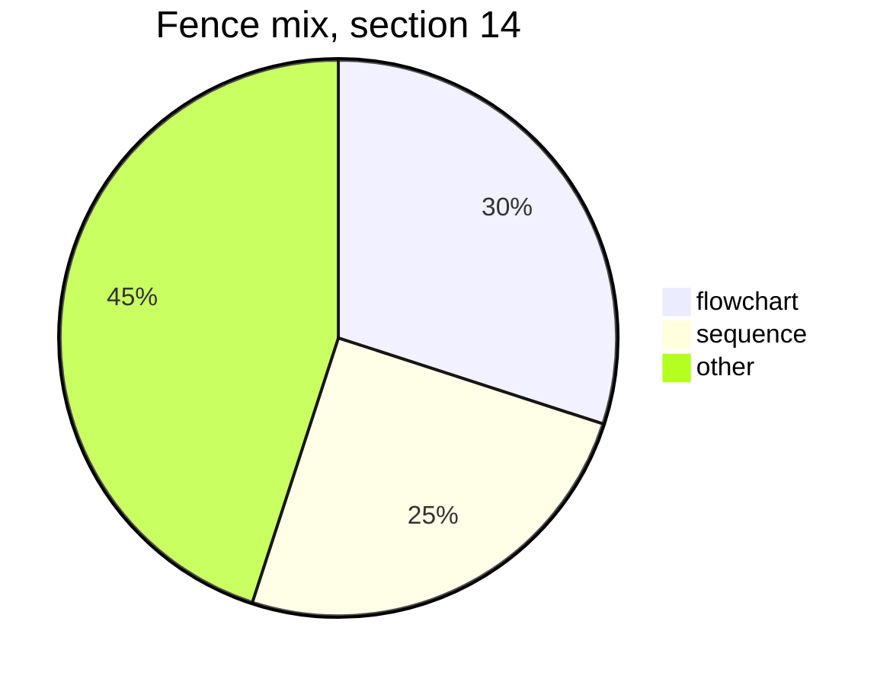

Prose after the fence, so the figure lands between two blocks of text and its margins can
be judged in flow.

## Section 15 - flowchart

Prose ahead of the fence, so the walk sees a reading column with text in it rather than a
wall of diagrams. The enhancement is post-paint (007 §3.3): this paragraph is on screen
before the engine has loaded, and the fence below is still a source fence at that instant.

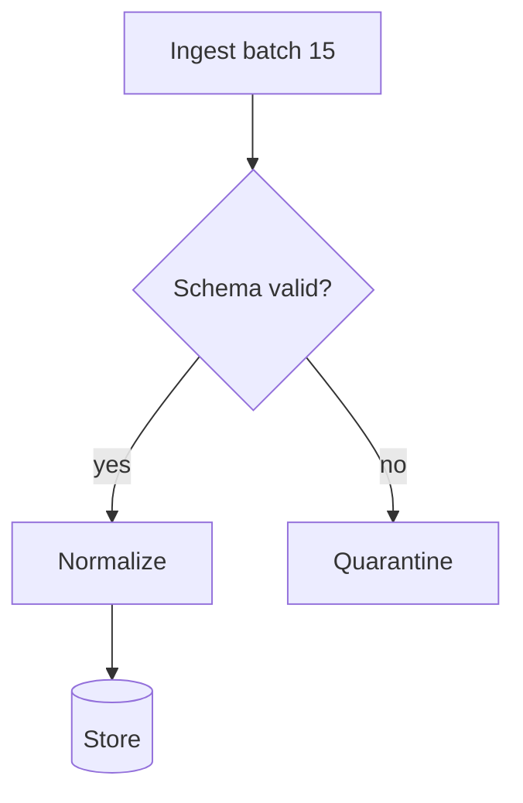

Prose after the fence, so the figure lands between two blocks of text and its margins can
be judged in flow.

## Section 16 - sequence

Prose ahead of the fence, so the walk sees a reading column with text in it rather than a
wall of diagrams. The enhancement is post-paint (007 §3.3): this paragraph is on screen
before the engine has loaded, and the fence below is still a source fence at that instant.

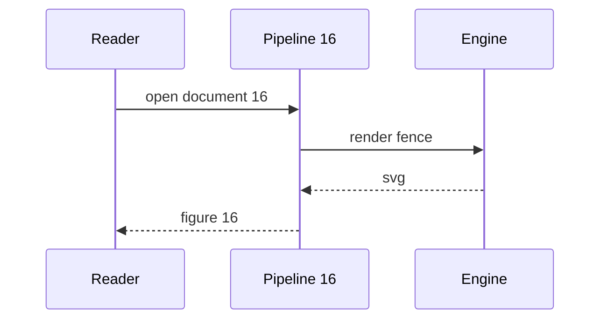

Prose after the fence, so the figure lands between two blocks of text and its margins can
be judged in flow.

## Section 17 - class

Prose ahead of the fence, so the walk sees a reading column with text in it rather than a
wall of diagrams. The enhancement is post-paint (007 §3.3): this paragraph is on screen
before the engine has loaded, and the fence below is still a source fence at that instant.

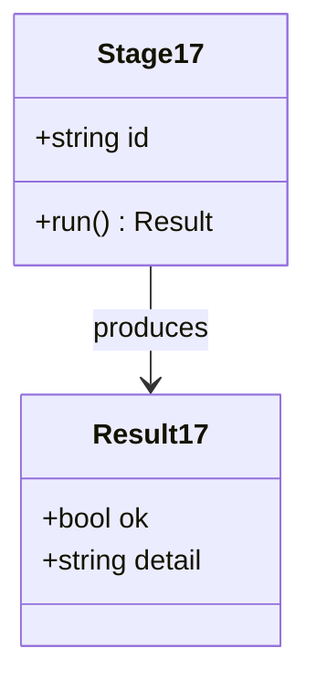

Prose after the fence, so the figure lands between two blocks of text and its margins can
be judged in flow.

## Section 18 - state

Prose ahead of the fence, so the walk sees a reading column with text in it rather than a
wall of diagrams. The enhancement is post-paint (007 §3.3): this paragraph is on screen
before the engine has loaded, and the fence below is still a source fence at that instant.

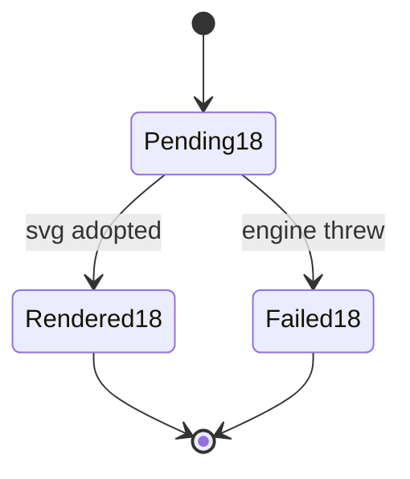

Prose after the fence, so the figure lands between two blocks of text and its margins can
be judged in flow.

## Section 19 - er

Prose ahead of the fence, so the walk sees a reading column with text in it rather than a
wall of diagrams. The enhancement is post-paint (007 §3.3): this paragraph is on screen
before the engine has loaded, and the fence below is still a source fence at that instant.

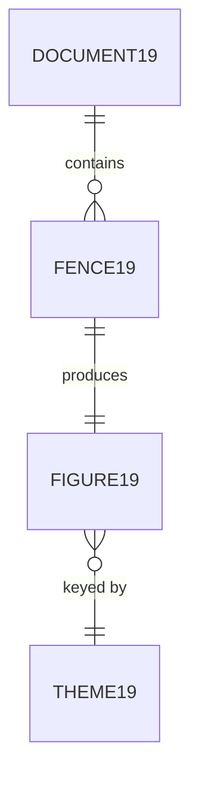

Prose after the fence, so the figure lands between two blocks of text and its margins can
be judged in flow.

## Section 20 - gantt

Prose ahead of the fence, so the walk sees a reading column with text in it rather than a
wall of diagrams. The enhancement is post-paint (007 §3.3): this paragraph is on screen
before the engine has loaded, and the fence below is still a source fence at that instant.


Prose after the fence, so the figure lands between two blocks of text and its margins can
be judged in flow.

## Section 21 - pie

Prose ahead of the fence, so the walk sees a reading column with text in it rather than a
wall of diagrams. The enhancement is post-paint (007 §3.3): this paragraph is on screen
before the engine has loaded, and the fence below is still a source fence at that instant.

```mermaid
pie title Fence mix, section 21
  "flowchart" : 30
  "sequence" : 25
  "other" : 45
```

Prose after the fence, so the figure lands between two blocks of text and its margins can
be judged in flow.

## Section 22 - flowchart

Prose ahead of the fence, so the walk sees a reading column with text in it rather than a
wall of diagrams. The enhancement is post-paint (007 §3.3): this paragraph is on screen
before the engine has loaded, and the fence below is still a source fence at that instant.

```mermaid
flowchart TD
  A22[Ingest batch 22] --> B22{Schema valid?}
  B22 -- yes --> C22[Normalize]
  B22 -- no --> D22[Quarantine]
  C22 --> E22[(Store)]
```

Prose after the fence, so the figure lands between two blocks of text and its margins can
be judged in flow.

## Section 23 - sequence

Prose ahead of the fence, so the walk sees a reading column with text in it rather than a
wall of diagrams. The enhancement is post-paint (007 §3.3): this paragraph is on screen
before the engine has loaded, and the fence below is still a source fence at that instant.

```mermaid
sequenceDiagram
  participant U as Reader
  participant P as Pipeline 23
  participant E as Engine
  U->>P: open document 23
  P->>E: render fence
  E-->>P: svg
  P-->>U: figure 23
```

Prose after the fence, so the figure lands between two blocks of text and its margins can
be judged in flow.

## Section 24 - class

Prose ahead of the fence, so the walk sees a reading column with text in it rather than a
wall of diagrams. The enhancement is post-paint (007 §3.3): this paragraph is on screen
before the engine has loaded, and the fence below is still a source fence at that instant.

```mermaid
classDiagram
  class Stage24 {
    +string id
    +run() Result
  }
  class Result24 {
    +bool ok
    +string detail
  }
  Stage24 --> Result24 : produces
```

Prose after the fence, so the figure lands between two blocks of text and its margins can
be judged in flow.

## Section 25 - state

Prose ahead of the fence, so the walk sees a reading column with text in it rather than a
wall of diagrams. The enhancement is post-paint (007 §3.3): this paragraph is on screen
before the engine has loaded, and the fence below is still a source fence at that instant.

```mermaid
stateDiagram-v2
  [*] --> Pending25
  Pending25 --> Rendered25 : svg adopted
  Pending25 --> Failed25 : engine threw
  Rendered25 --> [*]
  Failed25 --> [*]
```

Prose after the fence, so the figure lands between two blocks of text and its margins can
be judged in flow.

## Section 26 - er

Prose ahead of the fence, so the walk sees a reading column with text in it rather than a
wall of diagrams. The enhancement is post-paint (007 §3.3): this paragraph is on screen
before the engine has loaded, and the fence below is still a source fence at that instant.

```mermaid
erDiagram
  DOCUMENT26 ||--o{ FENCE26 : contains
  FENCE26 ||--|| FIGURE26 : produces
  FIGURE26 }o--|| THEME26 : "keyed by"
```

Prose after the fence, so the figure lands between two blocks of text and its margins can
be judged in flow.

## Section 27 - gantt

Prose ahead of the fence, so the walk sees a reading column with text in it rather than a
wall of diagrams. The enhancement is post-paint (007 §3.3): this paragraph is on screen
before the engine has loaded, and the fence below is still a source fence at that instant.

```mermaid
gantt
  title Enhancement pass 27
  dateFormat YYYY-MM-DD
  section Fence 27
  parse     :p27, 2026-08-01, 1d
  sanitize  :s27, after p27, 1d
  adopt     :a27, after s27, 1d
```

Prose after the fence, so the figure lands between two blocks of text and its margins can
be judged in flow.

## Section 28 - pie

Prose ahead of the fence, so the walk sees a reading column with text in it rather than a
wall of diagrams. The enhancement is post-paint (007 §3.3): this paragraph is on screen
before the engine has loaded, and the fence below is still a source fence at that instant.

```mermaid
pie title Fence mix, section 28
  "flowchart" : 30
  "sequence" : 25
  "other" : 45
```

Prose after the fence, so the figure lands between two blocks of text and its margins can
be judged in flow.

## Section 29 - flowchart

Prose ahead of the fence, so the walk sees a reading column with text in it rather than a
wall of diagrams. The enhancement is post-paint (007 §3.3): this paragraph is on screen
before the engine has loaded, and the fence below is still a source fence at that instant.

```mermaid
flowchart TD
  A29[Ingest batch 29] --> B29{Schema valid?}
  B29 -- yes --> C29[Normalize]
  B29 -- no --> D29[Quarantine]
  C29 --> E29[(Store)]
```

Prose after the fence, so the figure lands between two blocks of text and its margins can
be judged in flow.

## Section 30 - sequence

Prose ahead of the fence, so the walk sees a reading column with text in it rather than a
wall of diagrams. The enhancement is post-paint (007 §3.3): this paragraph is on screen
before the engine has loaded, and the fence below is still a source fence at that instant.

```mermaid
sequenceDiagram
  participant U as Reader
  participant P as Pipeline 30
  participant E as Engine
  U->>P: open document 30
  P->>E: render fence
  E-->>P: svg
  P-->>U: figure 30
```

Prose after the fence, so the figure lands between two blocks of text and its margins can
be judged in flow.

## Section 31 - class

Prose ahead of the fence, so the walk sees a reading column with text in it rather than a
wall of diagrams. The enhancement is post-paint (007 §3.3): this paragraph is on screen
before the engine has loaded, and the fence below is still a source fence at that instant.

```mermaid
classDiagram
  class Stage31 {
    +string id
    +run() Result
  }
  class Result31 {
    +bool ok
    +string detail
  }
  Stage31 --> Result31 : produces
```

Prose after the fence, so the figure lands between two blocks of text and its margins can
be judged in flow.

## Section 32 - state

Prose ahead of the fence, so the walk sees a reading column with text in it rather than a
wall of diagrams. The enhancement is post-paint (007 §3.3): this paragraph is on screen
before the engine has loaded, and the fence below is still a source fence at that instant.

```mermaid
stateDiagram-v2
  [*] --> Pending32
  Pending32 --> Rendered32 : svg adopted
  Pending32 --> Failed32 : engine threw
  Rendered32 --> [*]
  Failed32 --> [*]
```

Prose after the fence, so the figure lands between two blocks of text and its margins can
be judged in flow.

## Section 33 - er

Prose ahead of the fence, so the walk sees a reading column with text in it rather than a
wall of diagrams. The enhancement is post-paint (007 §3.3): this paragraph is on screen
before the engine has loaded, and the fence below is still a source fence at that instant.

```mermaid
erDiagram
  DOCUMENT33 ||--o{ FENCE33 : contains
  FENCE33 ||--|| FIGURE33 : produces
  FIGURE33 }o--|| THEME33 : "keyed by"
```

Prose after the fence, so the figure lands between two blocks of text and its margins can
be judged in flow.

## Section 34 - gantt

Prose ahead of the fence, so the walk sees a reading column with text in it rather than a
wall of diagrams. The enhancement is post-paint (007 §3.3): this paragraph is on screen
before the engine has loaded, and the fence below is still a source fence at that instant.

```mermaid
gantt
  title Enhancement pass 34
  dateFormat YYYY-MM-DD
  section Fence 34
  parse     :p34, 2026-08-01, 1d
  sanitize  :s34, after p34, 1d
  adopt     :a34, after s34, 1d
```

Prose after the fence, so the figure lands between two blocks of text and its margins can
be judged in flow.

## Section 35 - pie

Prose ahead of the fence, so the walk sees a reading column with text in it rather than a
wall of diagrams. The enhancement is post-paint (007 §3.3): this paragraph is on screen
before the engine has loaded, and the fence below is still a source fence at that instant.

```mermaid
pie title Fence mix, section 35
  "flowchart" : 30
  "sequence" : 25
  "other" : 45
```

Prose after the fence, so the figure lands between two blocks of text and its margins can
be judged in flow.

## Section 36 - flowchart

Prose ahead of the fence, so the walk sees a reading column with text in it rather than a
wall of diagrams. The enhancement is post-paint (007 §3.3): this paragraph is on screen
before the engine has loaded, and the fence below is still a source fence at that instant.

```mermaid
flowchart TD
  A36[Ingest batch 36] --> B36{Schema valid?}
  B36 -- yes --> C36[Normalize]
  B36 -- no --> D36[Quarantine]
  C36 --> E36[(Store)]
```

Prose after the fence, so the figure lands between two blocks of text and its margins can
be judged in flow.

## Section 37 - sequence

Prose ahead of the fence, so the walk sees a reading column with text in it rather than a
wall of diagrams. The enhancement is post-paint (007 §3.3): this paragraph is on screen
before the engine has loaded, and the fence below is still a source fence at that instant.

```mermaid
sequenceDiagram
  participant U as Reader
  participant P as Pipeline 37
  participant E as Engine
  U->>P: open document 37
  P->>E: render fence
  E-->>P: svg
  P-->>U: figure 37
```

Prose after the fence, so the figure lands between two blocks of text and its margins can
be judged in flow.

## Section 38 - class

Prose ahead of the fence, so the walk sees a reading column with text in it rather than a
wall of diagrams. The enhancement is post-paint (007 §3.3): this paragraph is on screen
before the engine has loaded, and the fence below is still a source fence at that instant.

```mermaid
classDiagram
  class Stage38 {
    +string id
    +run() Result
  }
  class Result38 {
    +bool ok
    +string detail
  }
  Stage38 --> Result38 : produces
```

Prose after the fence, so the figure lands between two blocks of text and its margins can
be judged in flow.

## Section 39 - state

Prose ahead of the fence, so the walk sees a reading column with text in it rather than a
wall of diagrams. The enhancement is post-paint (007 §3.3): this paragraph is on screen
before the engine has loaded, and the fence below is still a source fence at that instant.

```mermaid
stateDiagram-v2
  [*] --> Pending39
  Pending39 --> Rendered39 : svg adopted
  Pending39 --> Failed39 : engine threw
  Rendered39 --> [*]
  Failed39 --> [*]
```

Prose after the fence, so the figure lands between two blocks of text and its margins can
be judged in flow.

## Section 40 - er

Prose ahead of the fence, so the walk sees a reading column with text in it rather than a
wall of diagrams. The enhancement is post-paint (007 §3.3): this paragraph is on screen
before the engine has loaded, and the fence below is still a source fence at that instant.

```mermaid
erDiagram
  DOCUMENT40 ||--o{ FENCE40 : contains
  FENCE40 ||--|| FIGURE40 : produces
  FIGURE40 }o--|| THEME40 : "keyed by"
```

Prose after the fence, so the figure lands between two blocks of text and its margins can
be judged in flow.

## Section 41 - gantt

Prose ahead of the fence, so the walk sees a reading column with text in it rather than a
wall of diagrams. The enhancement is post-paint (007 §3.3): this paragraph is on screen
before the engine has loaded, and the fence below is still a source fence at that instant.

```mermaid
gantt
  title Enhancement pass 41
  dateFormat YYYY-MM-DD
  section Fence 41
  parse     :p41, 2026-08-01, 1d
  sanitize  :s41, after p41, 1d
  adopt     :a41, after s41, 1d
```

Prose after the fence, so the figure lands between two blocks of text and its margins can
be judged in flow.

## Section 42 - pie

Prose ahead of the fence, so the walk sees a reading column with text in it rather than a
wall of diagrams. The enhancement is post-paint (007 §3.3): this paragraph is on screen
before the engine has loaded, and the fence below is still a source fence at that instant.

```mermaid
pie title Fence mix, section 42
  "flowchart" : 30
  "sequence" : 25
  "other" : 45
```

Prose after the fence, so the figure lands between two blocks of text and its margins can
be judged in flow.

## Section 43 - flowchart

Prose ahead of the fence, so the walk sees a reading column with text in it rather than a
wall of diagrams. The enhancement is post-paint (007 §3.3): this paragraph is on screen
before the engine has loaded, and the fence below is still a source fence at that instant.

```mermaid
flowchart TD
  A43[Ingest batch 43] --> B43{Schema valid?}
  B43 -- yes --> C43[Normalize]
  B43 -- no --> D43[Quarantine]
  C43 --> E43[(Store)]
```

Prose after the fence, so the figure lands between two blocks of text and its margins can
be judged in flow.

## Section 44 - sequence

Prose ahead of the fence, so the walk sees a reading column with text in it rather than a
wall of diagrams. The enhancement is post-paint (007 §3.3): this paragraph is on screen
before the engine has loaded, and the fence below is still a source fence at that instant.

```mermaid
sequenceDiagram
  participant U as Reader
  participant P as Pipeline 44
  participant E as Engine
  U->>P: open document 44
  P->>E: render fence
  E-->>P: svg
  P-->>U: figure 44
```

Prose after the fence, so the figure lands between two blocks of text and its margins can
be judged in flow.

## Section 45 - class

Prose ahead of the fence, so the walk sees a reading column with text in it rather than a
wall of diagrams. The enhancement is post-paint (007 §3.3): this paragraph is on screen
before the engine has loaded, and the fence below is still a source fence at that instant.

```mermaid
classDiagram
  class Stage45 {
    +string id
    +run() Result
  }
  class Result45 {
    +bool ok
    +string detail
  }
  Stage45 --> Result45 : produces
```

Prose after the fence, so the figure lands between two blocks of text and its margins can
be judged in flow.

## Section 46 - state

Prose ahead of the fence, so the walk sees a reading column with text in it rather than a
wall of diagrams. The enhancement is post-paint (007 §3.3): this paragraph is on screen
before the engine has loaded, and the fence below is still a source fence at that instant.

```mermaid
stateDiagram-v2
  [*] --> Pending46
  Pending46 --> Rendered46 : svg adopted
  Pending46 --> Failed46 : engine threw
  Rendered46 --> [*]
  Failed46 --> [*]
```

Prose after the fence, so the figure lands between two blocks of text and its margins can
be judged in flow.

## Section 47 - er

Prose ahead of the fence, so the walk sees a reading column with text in it rather than a
wall of diagrams. The enhancement is post-paint (007 §3.3): this paragraph is on screen
before the engine has loaded, and the fence below is still a source fence at that instant.

```mermaid
erDiagram
  DOCUMENT47 ||--o{ FENCE47 : contains
  FENCE47 ||--|| FIGURE47 : produces
  FIGURE47 }o--|| THEME47 : "keyed by"
```

Prose after the fence, so the figure lands between two blocks of text and its margins can
be judged in flow.

## Section 48 - gantt

Prose ahead of the fence, so the walk sees a reading column with text in it rather than a
wall of diagrams. The enhancement is post-paint (007 §3.3): this paragraph is on screen
before the engine has loaded, and the fence below is still a source fence at that instant.

```mermaid
gantt
  title Enhancement pass 48
  dateFormat YYYY-MM-DD
  section Fence 48
  parse     :p48, 2026-08-01, 1d
  sanitize  :s48, after p48, 1d
  adopt     :a48, after s48, 1d
```

Prose after the fence, so the figure lands between two blocks of text and its margins can
be judged in flow.

## Section 49 - pie

Prose ahead of the fence, so the walk sees a reading column with text in it rather than a
wall of diagrams. The enhancement is post-paint (007 §3.3): this paragraph is on screen
before the engine has loaded, and the fence below is still a source fence at that instant.

```mermaid
pie title Fence mix, section 49
  "flowchart" : 30
  "sequence" : 25
  "other" : 45
```

Prose after the fence, so the figure lands between two blocks of text and its margins can
be judged in flow.

## Section 50 - flowchart

Prose ahead of the fence, so the walk sees a reading column with text in it rather than a
wall of diagrams. The enhancement is post-paint (007 §3.3): this paragraph is on screen
before the engine has loaded, and the fence below is still a source fence at that instant.

```mermaid
flowchart TD
  A50[Ingest batch 50] --> B50{Schema valid?}
  B50 -- yes --> C50[Normalize]
  B50 -- no --> D50[Quarantine]
  C50 --> E50[(Store)]
```

Prose after the fence, so the figure lands between two blocks of text and its margins can
be judged in flow.
